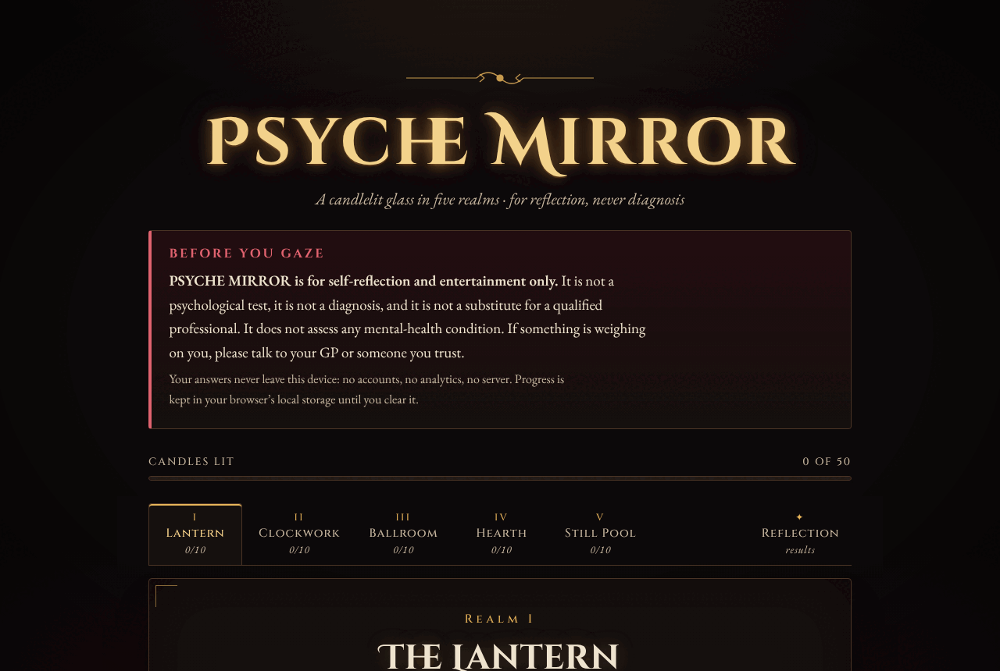
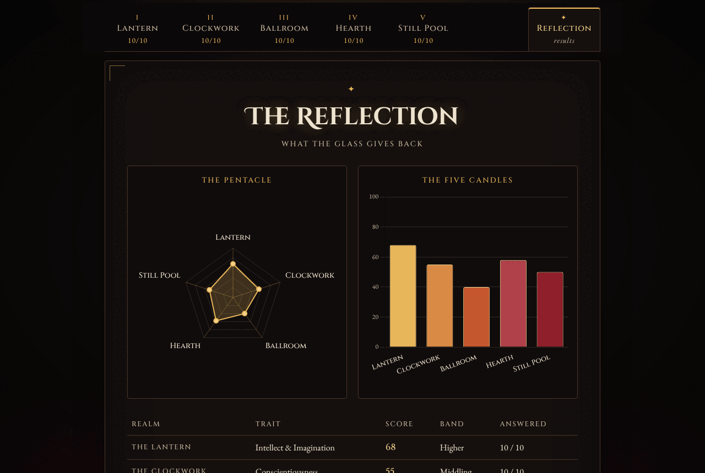

<div align="center">

# 🕯️ PSYCHE MIRROR 🕯️

### *A candlelit glass in five realms: for reflection, never diagnosis*



**Vanilla HTML · CSS · JavaScript** &nbsp;·&nbsp; **Chart.js** &nbsp;·&nbsp; **jsPDF** &nbsp;·&nbsp; **No backend, no analytics, no cookies** &nbsp;·&nbsp; **MIT**

</div>

---

> ### ⚠️ Before you gaze: the plain-English bit
>
> **PSYCHE MIRROR is for self-reflection and entertainment only.**
> It is **not** a psychological test, **not** a diagnosis, and **not** a substitute for a qualified professional.
> It does not screen for, measure or hint at any mental-health condition or neurodivergence, and its scores
> are not compared with any population or clinical norm.
> If something is weighing on you, please talk to your GP, a counsellor or someone you trust.
>
> The same disclaimer sits at the top of the page itself and in the footer of every exported PDF.

---

## 🦇 A Dramatic Opening

Come in, come in, and mind the step; it has been worn hollow by a century of the curious.

Draw the velvet curtain. Let the wind worry at the leaded windows; it has nothing to say that we need hear.
On the far wall, in a frame of tarnished brass, hangs a tall and patient mirror. It does not flatter.
It does not judge. It does not, despite what the village says, steal souls (we checked, and in any case
there's nowhere in the code to keep one). It simply asks fifty quiet questions by candlelight and shows you
your own outline in gold upon the dark.

Some mirrors tell you who is fairest of them all. This one is far too well brought up for that.
It merely holds up the glass, lights five candles, and leaves the rest to you, and to the fire, and possibly
to a small glass of something restorative.

## 🪞 What It Is

PSYCHE MIRROR is a static web app: a single page of hand-written HTML, CSS and JavaScript with no build step,
no framework and no server. You wander through **five realms**, rate fifty short statements about yourself on a
five-point scale, and the mirror returns:

- a **radar chart** (*The Pentacle*) and a **bar chart** (*The Five Candles*) of your five scores, drawn with Chart.js;
- a **score table** with each realm's 0–100 score, band and how many statements you answered;
- a short, **gothic-flavoured reading** for each realm, chosen by score band;
- a **PDF export** (*Seal it in a PDF*): an A4 parchment-coloured document with both charts, the table and every
  reading, built entirely in your browser with jsPDF;
- a **Clear my data** button that snuffs every candle and wipes your answers from the browser.

It is dressed in a candlelit palette of wax, flame-gold, ember and oxblood on a near-black ground, with Cinzel
Decorative and Cinzel for the ornamental headings and EB Garamond for the reading text. The fonts are bundled with
the site, so not even a typeface is fetched from elsewhere.



## 🏰 The Five Realms

Each realm is one tab and one of the five broad personality dimensions of the Big Five (OCEAN) model, as measured
by the public-domain **IPIP Big-Five Factor Markers** (Goldberg, 1992). Ten statements per realm, fifty in all.

| | Realm | Trait | Its question to you | Items (✚ / reverse) |
|---|---|---|---|---|
| **I** | 🏮 **The Lantern** | Intellect & Imagination | How far into the midnight library does your curiosity wander? | 7 / 3 |
| **II** | ⚙️ **The Clockwork** | Conscientiousness | Do you wind the great clock every Sunday, or tell the time by the light through the stained glass? | 6 / 4 |
| **III** | 💃 **The Ballroom** | Extraversion | Onto the floor beneath the chandeliers, or into the velvet alcove with a glass of something dark? | 5 / 5 |
| **IV** | 🔥 **The Hearth** | Agreeableness | When a stranger knocks on a stormy night, do you stoke the fire or peer through the keyhole? | 6 / 4 |
| **V** | 🌑 **The Still Pool** | Emotional Steadiness | When the wind rises, does the dark pool churn, or hold the moon perfectly still? | 2 / 8 |

A sixth tab, **✦ The Reflection**, shows your results. You can wander between realms in any order, leave
half-way and come back another night: the mirror remembers (see *Privacy*).

*The Still Pool* is the IPIP "Emotional Stability" scale, scored so that a higher number means a steadier pool.
It describes everyday mood steadiness as you rate it yourself, nothing more, and its readings are written
accordingly. None of the realms is, or stands in for, a clinical measure.

## ⚖️ How the Scoring Works

No crystal ball, I'm afraid; just arithmetic, done honestly. It lives in [`public/js/scoring.js`](public/js/scoring.js)
as pure functions with no DOM and no storage, which is why it can be tested in isolation.

1. **The scale.** Each statement is answered from **1** (*Very inaccurate*) to **5** (*Very accurate*).
2. **Reverse keying.** Some statements point the other way: agreeing with *"I keep in the background"* says less
   Ballroom, not more. For those **reverse-keyed** items the answer is flipped: **score = 6 − answer**, so 1↔5 and
   2↔4, and 3 stays put. Positively keyed items keep their answer as it is.
3. **Realm mean.** The keyed scores are averaged over the statements you actually answered in that realm.
4. **0–100.** The mean is rescaled so 1 becomes 0 and 5 becomes 100: **percent = (mean − 1) ÷ 4 × 100**, rounded to
   a whole number. (It's calculated with integer arithmetic before the one division, so the .5 cases round as
   they should.)
5. **Bands.** Each score falls into one of three bands, and each realm has its own reading for each band:

   | Score | Band | Epithet |
   |---|---|---|
   | 0–39 | **Lower** | *The Hush* |
   | 40–59 | **Middling** | *The Gloaming* |
   | 60–100 | **Higher** | *The Blaze* |

6. **Partial completion.** A realm is scored once **at least half** its statements (5 of 10) are answered; until
   then it's shown as *unscored*, and the mirror won't guess. A realm scored from fewer than all ten is marked
   **provisional** on the page and with an asterisk in the PDF. Results appear as soon as any one realm is scored.

A worked example: answer *"5 — Very accurate"* to every statement in **The Lantern** and you'd score
(7 × 5 + 3 × 1) ÷ 10 = 3.8, so **70**, *Higher*. Do the same in **The Still Pool**, where eight of the ten items
are reverse-keyed, and you'd score (2 × 5 + 8 × 1) ÷ 10 = 1.8, so **20**, *Lower*. That's reverse keying earning
its keep against anyone who'd lean on the one button all the way down.

Scores describe only how you answered on the day, relative to the middle of the scale. They are not percentiles,
they are not compared with anybody else, and a different mood on a different evening may well give a different
reflection.

## 🔒 Privacy: Everything Stays on Your Device

The mirror keeps its secrets because it never learns them in the first place.

- **No backend.** There is no server code, no database, no form submission and no webhook in this repository.
- **No analytics, no trackers, no cookies.** None. Not a pixel.
- **No third-party requests.** Chart.js, jsPDF and all the fonts are bundled in `public/`; the page fetches
  nothing from any other origin. On Netlify the Content Security Policy in `netlify.toml` enforces that with
  `connect-src 'none'` and `'self'`-only scripts, styles and fonts.
- **Local progress only.** Your answers and the tab you were last on are kept in your browser's `localStorage`
  under a single key, `psyche-mirror:v1`, so you can close the tab and return. Every read and write is wrapped in
  `try/catch`: in a private window, or with site data blocked, the mirror still works and simply forgets when you
  leave. Anything malformed found in storage is discarded rather than trusted.
- **Clear my data.** The button on the Reflection tab (with a confirmation, in case of a stray elbow) removes that
  key entirely.
- **The PDF is made in your browser** and handed straight to your downloads. It is never uploaded.

### 🪙 Optional pay-what-you-want support

The mirror is free. If you'd like to leave an offering, there's room for a **Stripe Payment Link**, and that's
all it is: a link. There are no Stripe keys, no Stripe.js and no checkout code here, and nothing about your
answers goes anywhere.

It is **off by default**. To switch it on, create a Payment Link in the Stripe Dashboard (choose *"Let customers
choose what to pay"*) and paste it into [`public/js/config.js`](public/js/config.js):

```js
window.PSYCHE_CONFIG = {
  stripePaymentLink: 'https://buy.stripe.com/your-link-here'
};
```

A small *"Keep the candles lit"* box then appears beneath the mirror. The app only accepts `https://buy.stripe.com/…`
or `https://donate.stripe.com/…` links, and while the setting is left empty the box stays hidden.

## 🕯️ Run It Locally

There's nothing to install. Choose your ritual:

**1. Just open it.** Double-click `public/index.html`. It works straight from `file://`, with no server.

**2. The bundled little server** (Node.js 18 or later, no dependencies):

```bash
npm start
# PSYCHE MIRROR is lit at http://localhost:8080
```

It serves `public/` on localhost only, with the same core security headers as production. Set `PORT=3000` to
change the port.

**3. Any static server you already have**, for instance:

```bash
python3 -m http.server 8080 --directory public
```

## ☁️ Deploy to Netlify

The repository is ready to go, with no build step. [`netlify.toml`](netlify.toml) publishes `public/` and sets the
security headers:

- `Content-Security-Policy`: everything `'self'`, `connect-src 'none'`, `frame-ancestors 'none'`, `object-src 'none'`
- `Strict-Transport-Security`, `X-Content-Type-Options: nosniff`, `X-Frame-Options: DENY`
- `Referrer-Policy: no-referrer`, a locked-down `Permissions-Policy`, `Cross-Origin-Opener-Policy` and `Cross-Origin-Resource-Policy`
- long-lived caching for the fonts

Choose one:

- **From Git:** push this repo to GitHub, then in Netlify go to *Add new site → Import an existing project*, pick
  the repo, and accept the settings it reads from `netlify.toml`.
- **Drag and drop:** drop the `public/` folder onto [app.netlify.com/drop](https://app.netlify.com/drop).
  (Headers come from `netlify.toml`, so they only apply to Git or CLI deploys of the whole repo.)
- **Netlify CLI:** `netlify deploy --prod` from the repository root.

## 🧪 Tests

The scoring and the storage layer are tested with Node's built-in test runner, **`node:test`**. There are no
dependencies, so there is no `npm install` and no `node_modules`.

```bash
npm test
```

**29 tests** cover:

- **The item bank:** five realms of ten, fifty unique ids, both keying directions in every realm, a reading for
  every band, and a check that no clinical or diagnostic vocabulary has crept into the questions or the readings.
- **Item scoring:** positive keying, reverse keying (1..5 → 5..1), and rejection of blank, out-of-range,
  fractional and string answers.
- **Band thresholds:** exact behaviour at 39 / 40 and 59 / 60, plus real answer patterns that land on 38, 40, 58
  and 60.
- **Whole-realm scoring:** all-high and all-low keyed answers giving 100 and 0, straight-line 3s giving exactly 50,
  straight-line 5s showing reverse keying at work, and a hand-worked mixed example.
- **Partial completion:** under half answered stays unscored, half or more is scored and flagged provisional,
  invalid stored values don't count, and overall progress adds up across the mirror.
- **Persistence:** save/load round-trip, corrupt JSON, a stale schema version, stripping unknown or invalid answers,
  clearing only the mirror's own key, and graceful failure when `localStorage` throws (as it can in private
  browsing) or is missing altogether.

The full flow (answering all five realms, reload persistence, both charts, the PDF download, keyboard tab
navigation, *Clear my data*, a 390 px phone width and opening from `file://`) was also checked by hand in headless
Chromium while building. That browser check isn't part of `npm test`.

## ♿ Accessibility

- Proper WAI-ARIA **tabs**: arrow keys, <kbd>Home</kbd> and <kbd>End</kbd> move between realms, with roving `tabindex`.
- Every statement is a `<fieldset>` with a `<legend>` and five real radio buttons, so it works with the keyboard and
  with screen readers.
- A visible focus ring, a *Skip to the mirror* link, a live progress bar, and text descriptions of both charts.
- Body text on the dark ground is around 15:1 contrast. The muted and accent colours were chosen to meet WCAG AA.
- **`prefers-reduced-motion`** turns off the title's candle flicker, the transitions and the chart animations.
- The layout reflows to a single column of answers on phones, with no sideways scrolling.

## 🗝️ Project Layout

```
psyche-mirror/
├── public/                 ← the whole site (Netlify publishes this)
│   ├── index.html
│   ├── css/style.css
│   ├── js/
│   │   ├── realms.js       ← the 50 IPIP items, keying and band readings
│   │   ├── scoring.js      ← pure scoring functions (tested)
│   │   ├── storage.js      ← localStorage persistence (tested)
│   │   ├── charts.js       ← Chart.js configs (screen + parchment themes)
│   │   ├── pdf.js          ← jsPDF export
│   │   ├── config.js       ← optional Stripe Payment Link
│   │   └── app.js          ← tabs, rendering, events
│   ├── vendor/             ← Chart.js 4.4.1, jsPDF 2.5.2 (with licences)
│   └── assets/             ← favicon, self-hosted fonts (with OFL licences)
├── tests/                  ← node:test suites
├── scripts/serve.js        ← zero-dependency local server
├── docs/                   ← screenshots
├── netlify.toml
└── package.json
```

## 📜 Credits

- **Questionnaire items:** the 50-item **IPIP Big-Five Factor Markers** from the
  [International Personality Item Pool](https://ipip.ori.org/), which is in the **public domain**.
  Goldberg, L. R. (1992). The development of markers for the Big-Five factor structure.
  *Psychological Assessment, 4*, 26–42. Here they are lightly adapted: each begins with "I", and spelling is Irish/British.
  The realm names, invitations and readings are original to this project.
- **[Chart.js](https://www.chartjs.org/)** 4.4.1, MIT licence, for the radar and bar charts.
- **[jsPDF](https://github.com/parallax/jsPDF)** 2.5.2, MIT licence, for the PDF export.
- **Fonts:** [Cinzel](https://github.com/NDISCOVER/Cinzel) and Cinzel Decorative by Natanael Gama, and
  [EB Garamond](https://github.com/octaviopardo/EBGaramond12) by Georg Duffner and Octavio Pardo, all under the
  SIL Open Font Licence 1.1, via [Fontsource](https://fontsource.org/).

Designed and built by **Niall O'Hara** in Skerries, Co. Dublin, where the wind off the Irish Sea does most of the
candle-flickering for free.

## ⚖️ Licence

[MIT](LICENSE) © 2026 Niall O'Hara. Bundled third-party files keep their own licences, as listed above and in `LICENSE`.

<div align="center">

---

*The candles gutter. The glass dims. Whatever you saw there, you saw it yourself, and it's yours to keep.*

🕯️

</div>
